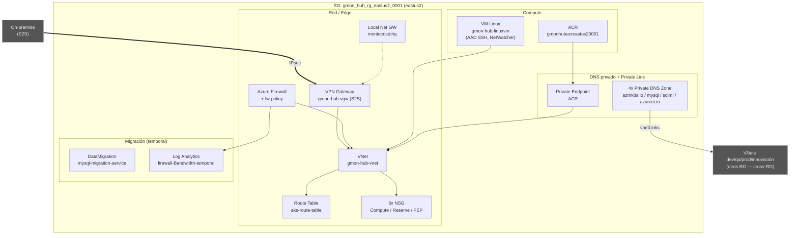

# Diagramas de arquitectura de un Resource Group — Procedimiento (dominio Azure)

> **Capacidad reutilizable del agente.** Cuando el usuario pida "diagramá el resource group X",
> "mostrame cómo se conectan los recursos de Y", o "visualizá la arquitectura de Z", seguir este
> procedimiento. Aplica a **todo el plano ARM** (VMs/VMSS, redes, Firewall, VPN Gateway, Storage,
> Key Vault, App Registrations/Managed Identity, SQL/SQL MI, ACR, AKS como recurso, Cognitive
> Services / Azure OpenAI "agentes IA", etc.), **no solo AKS**.

Destilado del skill `azure-resource-visualizer` (Microsoft), **adaptado a nuestro stack**: corre 100%
con `az` CLI (no depende del MCP `azure` oficial diferido), es **solo lectura**, y produce un diagrama
**Mermaid** que el dashboard de Kiro renderiza inline o se guarda en `docs/azure/<RG>-architecture.md`.

## Punto de partida, no un techo

El patrón de abajo (inventario → relaciones → Mermaid por capas) es la base. Adaptar y extender a lo
que la pregunta pida: distintas capas, KPIs, agrupar por otra dimensión, varios RG enlazados. No
limitarse a copiar la plantilla.

## Completitud vs. volumen — la regla que evita dejar algo afuera

**Acotar ≠ incompleto.** Son dos cosas distintas:

- **Completitud (innegociable):** `az resource list -g <RG>` devuelve **TODOS** los recursos del RG en
  una sola llamada. No se fragmenta la cobertura ni se omite ningún recurso "porque parece menor".
- **Volumen (manejo de salida):** si el JSON es grande, mandarlo a **archivo** y procesarlo en disco,
  no volcarlo al chat. El dato completo queda; solo cambia por dónde se lee. La regla de "filtrar/
  paginar" de la steering global es para listados **masivos cross-subscription** (todos los
  pipelines/repos/grupos de la org); **un RG individual ya es un scope acotado y se trae entero.**

### Los dos huecos reales (que `az resource list` NO muestra solo) — cubrir SIEMPRE

1. **Sub-recursos y relaciones internas:** subnets dentro de la VNet, reglas NSG, Private Endpoints,
   discos de una VM, bindings de identidad, virtualNetworkLinks de las Private DNS zones.
   `az resource list` lista el recurso **padre**; hay que hacer `az ... show` de cada uno para sacar
   las relaciones. Paso obligatorio, no opcional.
2. **Dependencias CROSS-RG:** un recurso del RG que apunta a algo **en otro RG** (una VM usando una
   VNet del hub, un App Service leyendo un Key Vault de otro RG, un peering, un Private DNS link a una
   VNet externa). El diagrama de "un RG" se perdería esa flecha. **Anotar explícitamente las
   dependencias externas al RG** en una sección "Dependencias externas". Para el panorama de varios RG
   relacionados: un diagrama por RG + un diagrama de nivel superior que muestre cómo se enlazan (mejor
   que un solo diagrama gigante ilegible).

## Flujo

```bash
# 0. Autenticar (SP de env/.env; el ~/.azure del agente está aislado, az login interactivo no lo alcanza)
set -a; source env/.env; set +a
az login --service-principal -u "$AZURE_CLIENT_ID" -p "$AZURE_CLIENT_SECRET" --tenant "$AZURE_TENANT_ID" --only-show-errors
az account set --subscription "$AZURE_SUBSCRIPTION_ID"

# 1. Inventario ENTERO del RG → archivo (no al chat)
OUT="/tmp/<RG>-resources.json"
az resource list -g <RG> -o json > "$OUT"

# 2. Detalle/relaciones de los recursos con conexiones (una llamada por recurso clave)
az network vnet show -g <RG> -n <vnet>            # subnets, address space, peerings
az network nsg show   -g <RG> -n <nsg>            # reglas → a qué subnet aplican
az network private-endpoint show -g <RG> -n <pe>  # a qué recurso/subnet conecta
#   ...identidad: az ad / az identity ; Key Vault access: az keyvault ...

# 3. Mapear relaciones: red / data flow / identidad / Key Vault / DNS privado
# 4. Generar Mermaid por capas (ver ejemplo real abajo)
# 5. Render: inline en el chat, o docs/azure/<RG>-architecture.md
```

**MCP `aks` NO sirve para esto** (opera ARM de AKS, no el inventario genérico del RG): usar `az` CLI.

## Reglas de uso

- **Solo lectura.** Inventario/análisis sin aprobación. Nunca modificar ni borrar recursos (`show`,
  `list`, `-o json`; jamás `create`/`delete`/`update`).
- **Secretos:** no imprimir connection strings, claves de Storage, secrets de Key Vault ni el SP.
  El diagrama muestra la **topología**, no los valores.
- Confirmar el RG contra el inventario en vivo (`az group list`) — nunca asumir que un nombre de RG
  citado en docs sigue vigente.

## Ejemplo vivo — `gmon_hub_rg_eastus2_0001` (hub de red, 52 recursos, 2026-10-02)

Hub de conectividad: VM Linux de administración, **Azure Firewall** con política, **VPN Gateway S2S**
hacia on-premise, **ACR** con Private Endpoint, y **4 Private DNS zones** cuyos virtualNetworkLinks
enlazan las VNets de dev/qa/prod/innovación hacia AKS, MySQL, SQL MI y ACR. Diagrama por capas:



**Dependencias externas (cross-RG) del hub, anotadas:** los 18 `virtualNetworkLinks` de las Private
DNS zones apuntan a **VNets que viven en otros RG** (dev `gmon_dev_rg`, qa, prod, innovación) para que
resuelvan AKS privado, MySQL, SQL MI y ACR por private link. El peering/ruteo real hacia esas VNets es
la flecha `EXT` — para verlas completas hay que diagramar también esos RG y enlazar los diagramas.

## Cruce con nuestras reglas

- Inventario/diagrama = **ciclo agéntico sin aprobación** (es lectura).
- Si al diagramar se detecta algo mal configurado de **infra**, se puede proponer corrección por el
  flujo estándar de Azure (plan→aprobación). El diagrama **no** cambia nada por sí mismo.
